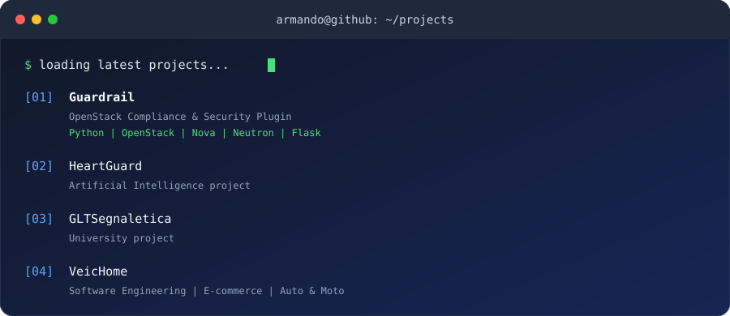

  

## 🚀 Chi sono

Sono un laureato in Informatica con una forte passione per lo sviluppo
software e le tecnologie web.\
Durante il mio percorso universitario ho sviluppato diversi progetti che
mi hanno permesso di acquisire competenze tecniche e capacità di
lavorare in team.

Sono una persona organizzata, motivata e sempre pronta ad affrontare
nuove sfide per migliorare le mie competenze.

------------------------------------------------------------------------

## 🛠️ Competenze Tecniche

### 💻 Linguaggi di Programmazione

  

------------------------------------------------------------------------

### 🌐 Sviluppo Web

------------------------------------------------------------------------

### 📱 Sviluppo Mobile

------------------------------------------------------------------------

## 🤝 Soft Skills

-   👥 Lavoro in team
-   🗣️ Comunicazione chiara
-   💡 Condivisione di idee
-   📊 Organizzazione del lavoro
-   ⏱️ Gestione delle scadenze
-   🧠 Problem solving

------------------------------------------------------------------------

# 🎓 Istruzione
🎓 Laurea Magistrale in Sicurezza Informatica e Tecnologie Cloud LM-66 (in corso)\
🎓 Laureato in Informatica L-31\
📖 Diploma - Sistemi Informativi Aziendali (SIA)\
📍 Avellino, Italia

------------------------------------------------------------------------

## 📫 Contatti

  
  

------------------------------------------------------------------------

## 📌 Progetti

Nel mio profilo GitHub sono disponibili i progetti sviluppati durante il
mio percorso universitario.

 rendi questo readme più carino
